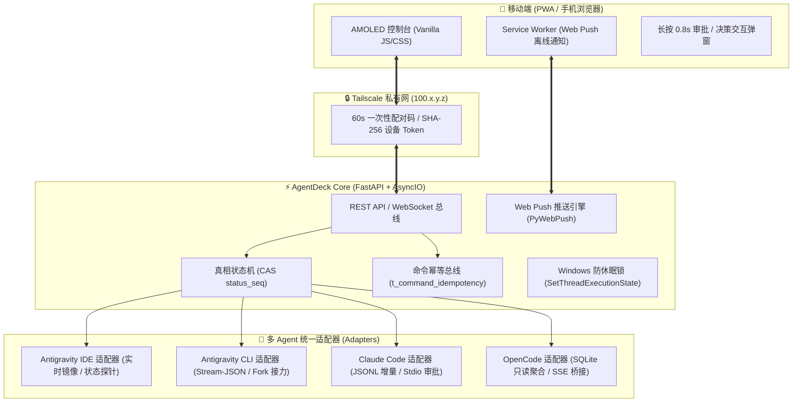

# ⚡ AgentDeck

<div align="center">

**基于 Tailscale 私有局域网的多 Agent 移动端统一中控台**

让 AI 编程走出电脑桌面。无论在沙发、通勤路上还是会议室，随时随地用手机查看会话、审批高危操作、应答交互决策、阅读计划文档并无缝接力对话。

[](https://www.python.org/)
[](https://fastapi.tiangolo.com/)
[](https://developer.apple.com/)
[](https://tailscale.com/)
[](https://opensource.org/licenses/MIT)

[✨ 核心特性](#-核心特性) • [🚀 快速开始](#-快速开始) • [📱 移动端与推送配置](#-移动端与-web-push-原生推送) • [🏗️ 系统架构](#-系统架构) • [🔧 常见问题](#-常见问题与排查)

</div>

---

## 💡 为什么需要 AgentDeck？

当你在本地使用 **Antigravity IDE**、**Claude Code** 或 **OpenCode** 执行复杂的多步骤编程任务时，Agent 经常会：
1. **请求高危工具审批**（如修改重要代码、执行终端命令、删除文件等），未批准则整条执行链路直接卡住；
2. **主动向开发者提问或索取方案决策**（Ask Question / User Confirmation），等待你的方向指示；
3. **输出长篇实施计划（Implementation Plan）与变更 Diff**，桌面端查看舒适，但离开电脑前就无法跟进。

传统远程桌面（TeamViewer / 向日葵 / RDP）在手机窄屏上操作鼠标键盘极度痛苦且延迟高。

**AgentDeck 的解决之道**：
打造一套**零公网暴露、开箱即用、专为手机窄屏人体工学优化**的轻量级中控台。通过 Tailscale 私网直连，不仅秒级同步桌面 Agent 执行进度，更提供**0.8 秒防误触长按审批**、**原生交互决策弹窗**、**全屏 Markdown 渲染**、**单列 Git Diff** 以及 **iOS / Android 原生 Web Push 离线推送**。

---

## ✨ 核心特性

### 1. 🤖 四大主流 Agent 全面纳管与无缝接力
- **Antigravity IDE (`~/.gemini/antigravity`)**：
  - 实时镜像桌面端 IDE 会话流。
  - **IDE 离线自动接力**：若电脑端 IDE 关闭，手机端发送指令时自动平滑转为 Antigravity CLI 继续执行。
  - **Fork-to-CLI 安全克隆**：支持从现有 IDE 会话安全衍生出独立 CLI 进程，杜绝多进程写入同一 SQLite 引起的数据库死锁或脑裂。
- **Antigravity CLI (`~/.gemini/antigravity-cli`)**：
  - 原生支持 `stream-json` 双向管道与多模型热切换。
- **Claude Code (`~/.claude/projects`)**：
  - 实时解析本地 `.jsonl` 会话流，精准清洗系统提示词噪音。
  - 支持 `--permission-prompt-tool stdio` 逐条工具权限拦截、双向放行与拒绝。
- **OpenCode (`~/.local/share/opencode`)**：
  - 毫秒级只读聚合本地 SQLite 历史，对接 `opencode serve` HTTP/SSE 双向流。
- **动态权限模式切换 (Permission Mode Switch)**：
  - 手机端支持动态切换 Agent 权限级别（`default` / `accept-edits` / `plan` / `bypass`），若底层 Agent 不支持则自动安全降级至人工逐条审批。

### 2. 📱 专为移动窄屏打磨的交互体验
- **iOS / Android 原生 Web Push 后台推送**：
  - 基于 VAPID 协议实现手机原生离线推送通知。当 Agent 任务完成（Done）、触发高危操作需人工审批、或等待交互决策时，手机立即收到横幅提醒，无需保持网页前台挂起。
- **高危操作 0.8s 蓄力长按审批 (`Hold-to-Approve`)**：
  - 针对 `rm -rf`、`git reset --hard`、`taskkill` 等高危命令，采用长按 0.8 秒填充进度条确认机制，彻底杜绝手机误触带来的灾难性后果；普通权限支持一键快捷通过。
- **原生交互决策弹框 (Interactive Decision Modal)**：
  - 深度支持 Agent 的问答与分歧选择交互（如选择架构方案 A/B、确认操作意图），手机端以原生弹窗交互一键提交选择，即刻解挂后台进程。
- **单列代码对比 (Unified Diff)** 与 **全屏 Markdown 阅读器**：
  - 针对 390px 左右手机宽度深度优化，文件级 Diff 展开即看。
  - 长篇 `implementation_plan.md`、设计规范等富文本一键沉浸全屏阅读。
- **性能与大输出保护**：
  - 单步工具输出超过 4KB / 100 行自动智能折叠，首屏会话消息流分页拉取，配合 GZip 压缩与内存 mtime 缓存，确保 60fps 丝滑滑动。
- **纯黑暗色美学**：
  - 遵循 `DESIGN.md` 规范，采用 AMOLED 纯黑底色 (`#000000`) 与冷中性 Zinc 炭黑层级，夜晚不刺眼，操作聚焦。

### 3. 🛡️ 状态真相与高可靠保障
- **会话真相状态机 (`creating / live / degraded / dead`)**：
  - 单调递增 CAS `status_seq` 护栏，所有前端状态严格由真相表驱动，彻底杜绝「假 RUNNING」与「幽灵会话」。
  - 底层 Agent 创建异常时自动降级为 `degraded` 状态并提示一键自愈重试，直连通道不中断。
- **命令幂等总线 (`t_command_idempotency`)**：
  - 弱网抖动重发、断线重连由幂等记录自动拦截重复执行；执行成功断线重连回放 ACK，失败允许重新提交。
- **卡死自愈与超时防护 (Hang Self-Healing)**：
  - 实时监控流式输出耗时与子进程健康状态，出现长时间失联或卡死时提供一键恢复与强制重试。

### 4. 🔒 零公网暴露与极速扫码配对
- **严禁公网暴露**：
  - 仅严格绑定本机 Tailscale 虚拟网卡 IP（`100.x.y.z`）与 `127.0.0.1`，绝不绑定 `0.0.0.0`。
- **60 秒一次性配对码 (`pair_code`)**：
  - 启动时终端与本地网页生成离线 SVG 二维码与一次性 60s 配对码，手机扫码后置换 SHA-256 长期授权 Token，有效防止截屏泄漏与 CSWSH 跨站劫持。
- **Windows 防休眠锁 (`SetThreadExecutionState`)**：
  - 手机端远程一键开启防休眠，允许显示器熄屏、主机不断网休眠，保证夜间或外出时后台任务稳定运行。
- **工作区与 Git 审查面板**：
  - 手机端直观查看本地工作区 Git 分支、未暂存与已暂存变动文件树，随时掌握代码演进。

---

## 🏗️ 系统架构



---

## 🚀 快速开始

### 1. 环境准备
- **Python**：`>= 3.11`
- **操作系统**：Windows 10/11、macOS、Linux（Windows 下提供原生托盘图标与防休眠锁）
- **网络连接**：电脑与手机加入同一个 [Tailscale](https://tailscale.com/) 网络（或仅在同一局域网/本机使用）

### 2. 安装项目依赖
```bash
# 克隆仓库
git clone https://github.com/xhma-code/AgentDeck.git
cd AgentDeck

# 安装依赖
pip install -e .
```

### 3. 一键启动
在 Windows 下直接双击运行 **`start.cmd`**，或通过命令行启动：

```bash
# 标准启动（自动启用热重载与端口防冲突检查）
python run.py

# 或通过全局命令启动（安装后）：
agentdeck
```

启动参数说明：
- `python run.py --doctor`：运行环境与 4 大 Agent 健康状况诊断体检。
- `python run.py --local-only`：仅监听 `127.0.0.1`，用于纯本机本地调试。
- `python run.py --port 8766`：指定自定义服务端口（默认 `8765`）。
- `python run.py --reload`：启用源码文件变动热重载模式。
- `python run.py --version`：打印当前版本号。
- **停止服务**：双击运行 `stop.cmd`，或在命令行按 `Ctrl+C`。

启动完成后，控制台将输出 **环境体检表** 及 **手机扫码配对二维码**。

---

## 📱 移动端与 Web Push 原生推送

### 1. 配对连接
1. 确保手机已开启 Tailscale 并连接到同一账号。
2. 打开手机相机，扫描控制台输出的二维码（或在电脑打开 `http://127.0.0.1:8765/` 查看高清二维码）。
3. 手机浏览器打开后，将在 60 秒内自动校验配对码并颁发长期凭证。

### 2. 启用 iOS / Android Web Push 原生推送（推荐）
为了在手机锁屏、微信聊天或离开网页时不错过 Agent 的审批与决策请求，建议开启 Web Push：
1. **iOS (iPhone / iPad)**：
   - 使用 **Safari** 打开配对成功的页面；
   - 点击浏览器底部的 **分享按钮 (Share)**，选择 **「添加到主屏幕」(Add to Home Screen)**；
   - 从桌面打开 AgentDeck App 图标；
   - 点击控制台右上角的 **🔔 推送开关**，在系统弹窗中允许通知权限。
2. **Android**：
   - 使用 Chrome 或 Edge 打开页面，在菜单中选择 **「安装应用」** 或 **「添加到主屏幕」**；
   - 打开应用并允许通知权限即可。

---

## 📖 接口文档与开放 API

AgentDeck 基于 FastAPI 提供了完备的 RESTful 与 WebSocket API：
- **Swagger UI 交互式文档**：[http://127.0.0.1:8765/docs](http://127.0.0.1:8765/docs)
- **ReDoc 规范文档**：[http://127.0.0.1:8765/redoc](http://127.0.0.1:8765/redoc)
- **核心探针接口**：
  - `GET /healthz` 或 `GET /api/v1/health`：返回健康状态（免鉴权，便于容器探活与状态监控）
  - `GET /api/v1/system/status`：返回包含 Tailscale 状态、系统指标与 4 大 Agent 健康度的体检数据

---

## 📂 项目结构

```text
AgentDeck/
├── backend/                    # 后端核心源码
│   ├── adapters/               # 多 Agent 协议与持久化适配器
│   │   ├── base.py             # 统一抽象基类、Diff 生成器与高危规则
│   │   ├── antigravity_adapter.py  # Antigravity IDE/CLI 适配器与自动接力
│   │   ├── antigravity_fork.py # Fork-to-CLI 安全会话克隆引擎
│   │   ├── claude_adapter.py   # Claude Code JSONL 增量解析与清洗
│   │   └── opencode_adapter.py # OpenCode SQLite 聚合与 HTTP 桥接
│   ├── core/                   # 基础设施核心
│   │   ├── database.py         # SQLite 元数据库、状态快照与锁保护
│   │   ├── logger.py           # 结构化中文三段式诊断日志 (Problem/Cause/Fix)
│   │   ├── network.py          # 端口监听状态与占用自动释放
│   │   └── tailscale_auth.py   # Tailscale 适配、配对鉴权与防休眠锁
│   ├── engines/                # 运行时调度引擎
│   │   ├── approval.py         # 工具权限审批状态机 (0.8s 长按防误触)
│   │   ├── event_bus.py        # 全双工事件总线与广播
│   │   ├── process_pool.py     # 子进程池管理与生命周期监控
│   │   └── watcher.py          # 本地文件与会话流 Watchfiles 监听
│   └── routes/                 # FastAPI 路由模块
│       ├── auth.py             # 扫码配对与 Token 签发
│       ├── push.py             # Web Push (VAPID) 订阅与推送调度
│       ├── sessions.py         # 会话 CRUD、消息收发与决策应答
│       ├── static_pwa.py       # PWA 静态资源与 Service Worker 托管
│       ├── system.py           # 系统状态、防休眠控制与体检
│       ├── websocket.py        # 实时事件管道与断线对账
│       └── workspaces.py       # 工作区扫描与 Git 状态面板
├── frontend/                   # 零打包依赖的前端移动端工作台
│   ├── index.html              # 响应式骨架与模态框
│   ├── styles.css              # 纯黑设计系统与微动效
│   ├── app.js                  # 状态机驱动的前端逻辑与 PWA 管理
│   └── sw.js                   # Service Worker 与 Web Push 后台捕获
├── tests/                      # 单元测试与集成测试
├── run.py                      # 一键启动器 (Launcher & Supervisor)
├── start.cmd / stop.cmd        # Windows 快捷启停批处理
└── pyproject.toml              # 项目配置与依赖声明
```

---

## 🔧 常见问题与排查 (Troubleshooting)

| 现象 | 可能原因 | 快速解决措施 |
| :--- | :--- | :--- |
| **控制台提示「未检测到活跃 Tailscale」** | 电脑未安装或未登录 Tailscale 客户端 | 运行 `tailscale up` 进行登录。若仅在电脑本地使用，服务将自动回退为 `127.0.0.1` 仅本机模式。 |
| **手机扫码提示「配对码已失效」** | 二维码配对码具备 60 秒时效性，超时未扫码 | 刷新电脑端 `http://127.0.0.1:8765/` 或重启服务重新生成新二维码。 |
| **手机无法打开 Tailscale IP** | 手机与电脑未加入同一 Tailnet，或被防火墙拦截 | 检查手机端 Tailscale App 是否开启连接，并确认登录同一账号；Windows 需放行专用网络端口入站规则。 |
| **收不到 Web Push 推送通知** | 未将网页「添加到主屏幕」或未授权通知 | iOS 限制只有从主屏幕图标启动的 PWA 才能接收 Web Push。请严格按指南使用 Safari「添加到主屏幕」后启动并授权。 |
| **会话出现 amber「直连/降级」徽标** | 底层服务离线或进程创建未就绪 | CLI 直连通道依然可以正常交互。点击页面顶部的「重试」横幅可尝试重新与底层建立完整连接。 |
| **端口占用错误 (Errno 10048)** | 上次退出残留或被其他程序占用 | 运行 `stop.cmd` 清理残留进程，或使用 `python run.py --port 8766` 切换端口启动。 |

---

## 📄 开源许可证

本项目基于 [MIT License](https://opensource.org/licenses/MIT) 开源。
