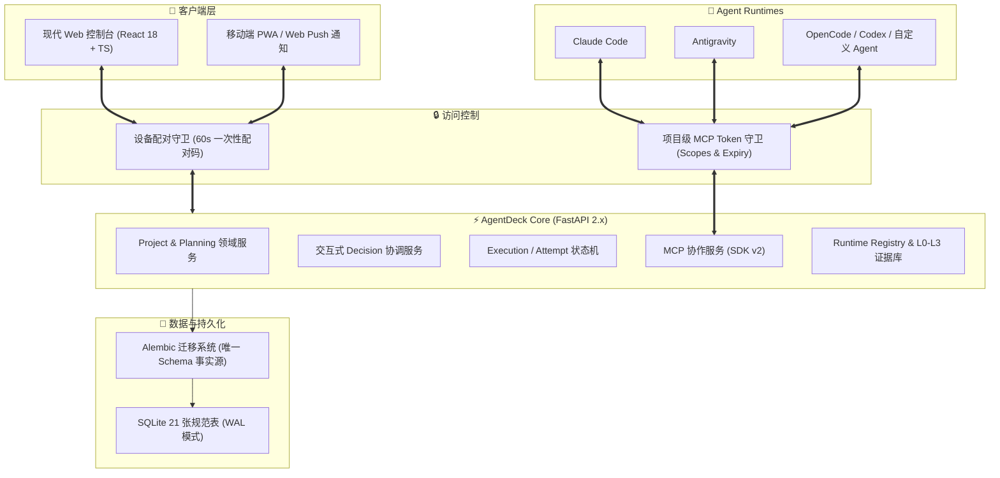

# ⚡ AgentDeck

<div align="center">

**多项目 AI 研发异步编排驾驶舱与标准 MCP 协作中枢**

基于第一性原理打造的轻量级 AI 协同底座：统一项目管理、任务演进、决策门禁、审计追踪与 Agent Runtime 接入。  
随时随地在桌面端与移动端掌控多项目研发进度，应答协作决策，查看交付物成果。

[](https://www.python.org/)
[](https://fastapi.tiangolo.com/)
[](https://react.dev/)
[](https://modelcontextprotocol.io/)
[](https://alembic.sqlalchemy.org/)
[](https://tailscale.com/)
[](https://opensource.org/licenses/MIT)

[✨ 核心设计原则](#-核心设计原则) • [🚀 核心能力](#-核心能力) • [🏗️ 系统架构](#-系统架构) • [🏁 快速开始](#-快速开始) • [📱 移动端与通知](#-移动端与通知) • [📂 模块布局](#-代码目录布局)

</div>

---

## 💡 核心设计原则

> **“AgentDeck 管理工作，Agent Runtime 负责推理和实际执行”**

AgentDeck 不是另一个自研 Agent，也不是各 Agent 内部会话与私有数据库的逆向镜像器：
1. **边界清晰**：AgentDeck 负责项目工作分解、修订历史、人工决策门禁、交付物归档与审计链路；底层 Agent（如 Claude Code, Antigravity, OpenCode, Codex 等）负责上下文推理、代码编写、终端执行与原生工具审批。
2. **状态分离**：严格分离平台管理状态（`platform_status`）、Agent 自报状态（`agent_reported_status`）、Runtime 健康状态（`runtime_status`）与网络连接状态（`connection_status`）。
   - **Agent 自报完成 ≠ 平台验收完成**
   - **Remote 连接断线 ≠ 任务执行失败**
3. **真实证据优先**：Capability Manifest 与能力等级（L0-L3）必须以端到端实测证据为准，不将简单的远程 URL 或安装 SDK 谎报为高阶程序化控制能力。

---

## ✨ 核心能力

### 1. 📁 Project-First 多项目与任务演进主线
- **项目第一公民**：以 `Project` 为最小隔离单元，彻底杜绝跨项目混淆。
- **任务与步骤追加修订**：`Project → Task → Step` 树状结构；所有变更均以 `TaskRevision` / `StepRevision` 追加留痕，随时可回溯与断点续作。

### 2. 🔀 三层协作实体解耦
- **Session（协同会话）**：记录人类与 Agent 协同讨论的顶层通道。
- **Execution（业务执行单）**：代表针对特定任务步骤发起的一次业务调度目标。
- **ExecutionAttempt（单次执行尝试）**：代表对执行单的具体尝试；网络抖动或失败时追加 Attempt 尝试，不破坏前序执行审计记录。初始为 `queued`，确认开始执行后进入 `running`。

### 3. 🔌 标准 MCP 协作中枢（Agent → AgentDeck）
- **官方 SDK v2 规范**：集成官方 `mcp>=2.0.0`，原生支持无状态 `2026-07-28` 协议及 `2025-11-25` 旧版本兼容分发。
- **最小权限 Token 守卫**：每个 MCP 令牌（`agmcp_...`）强制绑定单一项目与特定 scopes，校验有效期与吊销状态，绝不复用 Web 端本机免密规则。
- **8 大标准协同工具**：
  - 项目上下文与任务读取（`project_context_get`, `task_get`, `task_revision_get`）
  - 进度汇报与步骤回写（`task_report_progress`, `step_update`）
  - 人工决策门禁挂起与查询（`checkpoint_request`, `decision_get`）
  - 项目交付物注册（`artifact_register`）

### 4. 🎛️ Runtime Registry 与 L0-L3 能力阶梯
- **RuntimeProvider / RuntimeInstance / Machine** 分层建模，管理多宿主机器与不同 Agent 运行时。
- **能力等级**：
  - `L0 (Remote Entry)`：提供官方 Web/Remote 入口跳转；
  - `L1 (Registry & Status)`：具备实例注册、心跳健康与能力清单查询；
  - `L2 (Programmatic Control)`：支持通过 API/CLI 发起执行并获取结构化反馈；
  - `L3 (Approval & Resume)`：支持深度门禁拦截、决策注入与断点恢复。

### 5. ⚖️ 交互式决策门禁 (Decision Modal)
- 当 Agent 遭遇关键分歧、方案选择或风险卡点时，通过 AgentDeck 发起全局 `Decision`。
- **超时策略**：低风险交互支持 45 秒倒计时自动采纳推荐项；高风险门禁（`risk_gate` / `high` / `critical`）强制人工手动确认，防止静默越权。

### 6. 🔒 零公网暴露与移动端体验
- 默认监听 `127.0.0.1` 与 Tailscale / ZeroTier 私有虚拟网卡，**严禁公网 `0.0.0.0` 暴露**。
- 手机扫码 60 秒一次性配对码快速鉴权；支持 iOS / Android 原生 Web Push 离线通知。

---

## 🏗️ 系统架构



---

## 🏁 快速开始

### 1. 环境依赖
- **Python**：`>= 3.11`
- **Node.js**：`>= 18`（仅前端二次开发需要；已内置编译产物）

### 2. 安装部署
```bash
# 克隆仓库
git clone https://github.com/xhma-code/AgentDeck.git
cd AgentDeck

# 安装 Python 运行依赖
pip install -e .
```

### 3. 一键启动
```bash
# 启动主服务（自动对齐 Alembic 数据库迁移）
python run.py

# 启动环境健康体检
python run.py --doctor

# 仅在本机 127.0.0.1 模式运行（不绑定 Tailscale 网卡）
python run.py --local-only
```

启动完成后，控制台将输出 **环境体检表** 及 **手机扫码配对二维码**。访问终端打印的本地地址（默认 `http://127.0.0.1:8765/`）即可打开工作台。

---

## 📱 移动端与通知

1. **手机配对**：手机与电脑处于同一 Tailscale 虚拟局域网（或同 Wi-Fi）下，使用手机相机扫描终端输出的二维码即可免密建立受信任设备配对。
2. **Web Push 原生离线推送**：在手机浏览器中选择「添加到主屏幕」，点击控制台右上角推送铃铛，即可在锁屏状态下接收 Agent 决策请求与任务验收提醒。

---

## 📂 代码目录布局

```text
AgentDeck/
├── backend/                    # 后端核心源码 (FastAPI 2.x + SQLAlchemy 2.x)
│   ├── api/                    # REST API 路由、Schemas 与请求依赖守卫
│   ├── application/            # 应用服务编排 (Project, Planning, Decision, Execution, Session)
│   ├── domain/                 # 核心领域实体、枚举类型与安全策略
│   ├── mcp/                    # 基于官方 SDK v2 的 MCP Server、工具集与 Stdio 服务
│   ├── db/                     # ORM 模型定义、Engine 工厂与 Alembic 迁移管理器
│   ├── migrations/             # Alembic 迁移脚本（Schema 演进唯一事实源）
│   ├── security/               # 设备配对 AuthGuard 与项目级 McpTokenGuard
│   └── core/                   # 结构化日志、网络探测、WebPush 与防休眠锁
├── frontend/                   # 前端现代单页应用 (React 18 + TypeScript + Vite)
│   ├── src/                    # 前端源码 (组件、API 客户端、类型定义)
│   └── dist/                   # 生产静态资源构建目录
├── docs/                       # 架构设计与分阶段演进文档
├── tests/                      # 自动化测试与领域不变量验证套件
├── alembic.ini                 # Alembic 配置文件
├── run.py                      # 一键启动器与环境诊断体检入口
└── pyproject.toml              # 项目元数据与依赖定义
```

---

## 📄 开源许可证

本项目基于 [MIT License](https://opensource.org/licenses/MIT) 开源。
